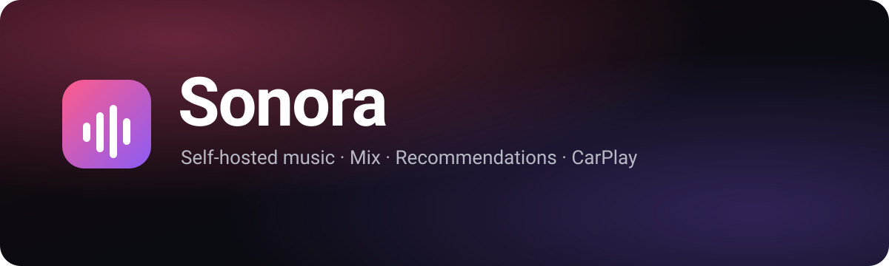
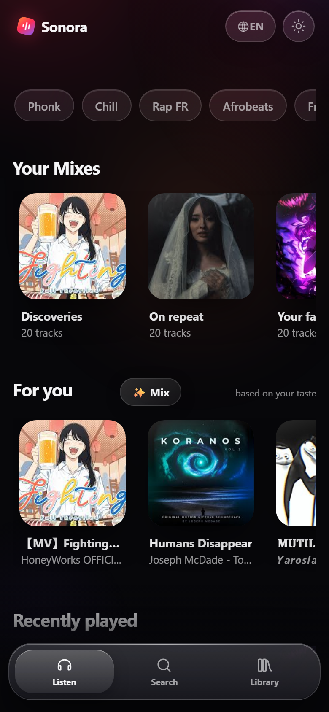
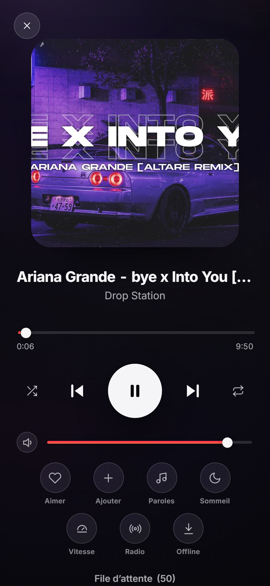
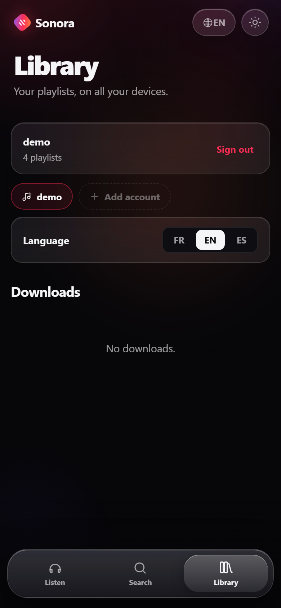
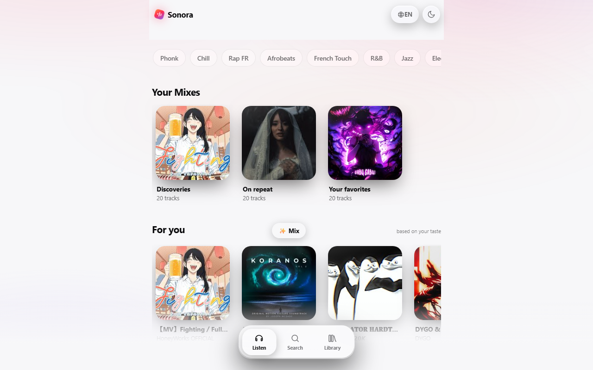

# Sonora



[](https://github.com/heidman06/sonora/actions/workflows/ci.yml)
[](https://github.com/heidman06/sonora/releases)
[](LICENSE)

Self-hosted music PWA with an Apple Music / Spotify feel: Mix radio, personalized recommendations, daily mixes, playlist management, Subsonic gateway for CarPlay, and offline playback.

## Features

- **Mix radio**: 30 tracks blending discoveries, likes, history and playlists
- **Daily Mixes**: Discoveries / On repeat / Favorites
- **Recommendations v3**: Piped related tracks + weighted artist affinities, versioned cache, stale-while-revalidate
- **Recommendation feedback**: dismiss (x) or like recommendations directly from the home screen
- **Subsonic gateway** for **CarPlay / Amperfy**: playlists, albums, artists, search, artwork, streaming
- **Offline downloads**: IndexedDB blob storage, playback without network
- **Real durations** for playlists, likes, history and Subsonic
- **Multi-account**: scrypt passwords, bearer sessions, per-account isolation
- **Security**: 30-day session TTL, server-side logout revocation, input validation
- **Mobile-first PWA**: English (default), French and Spanish UI, light/dark theme
- **iOS background playback**: native HLS queue so tracks keep advancing when the PWA is backgrounded or the screen is locked

## Screenshots

<table>
  <tr>
    <td align="center"><br><sub>Home and Daily Mixes</sub></td>
    <td align="center"><br><sub>Full-screen player</sub></td>
    <td align="center"><br><sub>Library and downloads</sub></td>
  </tr>
  <tr>
    <td colspan="3" align="center"><br><sub>Desktop, light theme</sub></td>
  </tr>
</table>

The app UI is available in English (default), French and Spanish; the documentation is in English. Screenshots use a demo account.

## React client

The web client lives in `frontend/`: **React 19 + Vite 7 + TypeScript strict**, with the legacy vanilla client preserved at `/musique-legacy/` as a rollback path. The prebuilt client is shipped in `web/`; `frontend/` remains the source of truth.

```bash
npm --prefix frontend install
npm --prefix frontend run dev   # http://127.0.0.1:5174/musique/
npm --prefix frontend run build
```

The Docker image ships the prebuilt React client in `/app/web` and the legacy client in `/app/web-legacy`.

## Architecture

    web/ (built React client)  ->  Node hub (API /api/mus, /subsonic/rest, /musique/dl)
                                |
                                +- server/musique.mjs (auth, playlists, likes, history, recos, Mix)
                                +- server/subsonic.mjs (CarPlay gateway)
                                +- server/durees.mjs (duration cache via Piped)
                                +- server/audio.mjs (yt-dlp cache, Range 206, progressive streaming)

Storage: SQLite (node:sqlite) + yt-dlp m4a cache + optional Piped instance.

## Quick start (Docker)

    git clone https://github.com/heidman06/sonora.git
    cd sonora
    mkdir -p data
    # optional: YouTube cookies for yt-dlp (Netscape format)
    docker compose up -d --build
    # open http://127.0.0.1:3011/musique/

The image bundles Node 24, yt-dlp and ffmpeg. Data lives in ./data (SQLite, cookies, audio cache).

## Local development

Requirements: Node.js 24+, yt-dlp, ffmpeg, optional Piped instance.

    cp .env.example .env
    npm install --no-audit --no-fund
    npm run check
    npm test
    SONORA_DATA=./data PIPED_URL=http://127.0.0.1:8081 node server/index.mjs

Open http://127.0.0.1:3011/musique/. Two demo accounts are seeded on first run; see data/musique-users.txt.

## CarPlay (Amperfy)

Sonora exposes a Subsonic-compatible API at **/subsonic/rest**. Amperfy (App Store, CarPlay support) can browse playlists, albums and artists and play streams.

1. Install Amperfy
2. Add server: https://your-domain.tld/subsonic
3. Use legacy login with your Sonora credentials

Full guide: [docs/CARPLAY.md](docs/CARPLAY.md).

## Tests and load

    npm test                  # 18 tests (recos, API, Subsonic, input validation)
    npm run load              # optional load test (SONORA_USER/PASSWORD required)

## Documentation

- [API contract](docs/API.md)
- [CarPlay / Amperfy guide](docs/CARPLAY.md)
- [Open-source checklist](docs/OSS-CHECKLIST.md)
- [Publishing guide](docs/PUBLISH.md)
- [Roadmap](docs/ROADMAP.md)
- [Contributing](CONTRIBUTING.md)
- [Security](SECURITY.md)
- [Changelog](CHANGELOG.md)

## License and third-party

MIT - see [LICENSE](LICENSE). Third-party notices: [NOTICE](NOTICE). No music content is distributed: Sonora streams media via yt-dlp/Piped.
