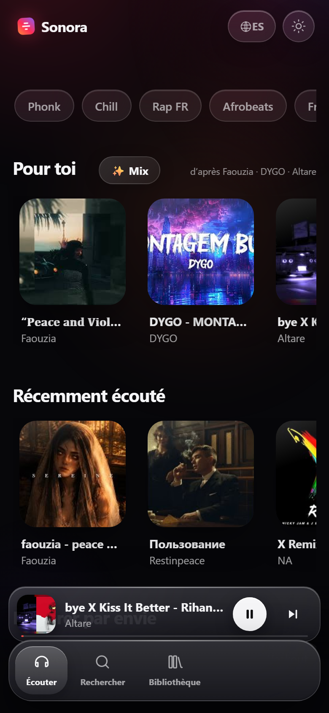

# Sonora

PWA musique auto-hébergée, style Apple Music / Spotify, avec un vrai moteur de recommandations et un Mix radio.

> **Statut : alpha open source (v1.3, 2026-11-24).** Serveur autonome disponible (`server/index.mjs`),
> configuration par variables d'environnement, smoke test 13 vérifications. Reste : Dockerfile, CI, tests hors machine (voir docs/OSS-CHECKLIST.md).

## Fonctionnalités

- Lecture audio (m4a) avec cache serveur, Range/seek, reprise, file d'attente, mode aléatoire/répétition.
- Comptes multi-utilisateurs (auth scrypt, Bearer, données séparées).
- Playlists, favoris, historique, import Spotify.
- **Recommandations v3** : titres liés via Piped + affinités pondérées (likes, historique par récence, playlists), filtrage des titres parasites, déduplication, cache SQLite 3 h en stale-while-revalidate.
- **Mix** : radio de 30 titres mêlant découvertes, favoris, historique et playlists (cache 45 min).
- **Durées réelles** : playlists, favoris et historique affichent les durées (cache `track_meta` rempli via Piped).
- **Hors-ligne** : téléchargement des titres (IndexedDB) et lecture depuis le blob local, même si le flux réseau est coupé.
- **Feedback recos** : bouton ✕ sur « Pour toi » (dismiss) pour affiner les recommandations.
- **Daily Mixes** : 3 mix personnalisés (Découvertes / En boucle / Tes favoris) affichés sur l'accueil.
- PWA mobile-first, thème clair/sombre, FR/ES, lecture en arrière-plan iOS.
- Endpoint `/health` public + smoke test automatisé (timer toutes les 15 min).

## Architecture

```
web/ (PWA statique)  →  hub Node (API /api/mus, /api/piped, /musique/dl)
                              │
                              ├─ server/musique.mjs (SQLite, recos, mix, auth)
                              ├─ server/musique-resolve.mjs (imports Spotify)
                              └─ yt-dlp + cache data/musique/<id>.m4a
```

## Prérequis

- Node.js >= 24 (`node:sqlite`)
- yt-dlp + ffmpeg + cookies YouTube valides
- Une instance Piped (optionnelle, pour la recherche) ou le fallback yt-dlp du hub

## Démarrage rapide

Le serveur autonome est disponible : `server/index.mjs` (API + audio + PWA + proxy Piped optionnel).

```bash
npm --version >/dev/null 2>&1 || true
mkdir -p data
cp .env.example .env   # adapter les chemins
cp /chemin/yt-cookies.txt data/yt-cookies.txt && chmod 600 data/yt-cookies.txt
SONORA_DATA=./data PIPED_URL=http://127.0.0.1:8081 node server/index.mjs
# → http://127.0.0.1:3011/musique/
```

Variables principales : `SONORA_PORT`, `SONORA_HOST`, `SONORA_DATA`, `SONORA_COOKIES`, `YTDLP_PATH`, `FFMPEG_PATH`, `SONORA_NODE_BIN`, `SONORA_EJS`, `SONORA_CACHE_MAX_BYTES`, `PIPED_URL`.

## CarPlay (Amperfy)

Sonora expose une **passerelle Subsonic** compatible avec [Amperfy](https://apps.apple.com/app/amperfy/id1510865828) (CarPlay natif) :

1. Installer **Amperfy** sur l'iPhone.
2. Ajouter un serveur : URL `https://votre-domaine.tld:8451/subsonic` (ou l'URL de votre instance), type **Subsonic**.
3. Au login, choisir le mode **legacy** (mot de passe) — Amperfy v1.0.7+ le propose.
4. Identifiants : ceux de Sonora (`heid` / `maria`).

La passerelle traduit playlists, favoris, recherche, pochettes et streams vers le protocole Subsonic.
Guide détaillé : [docs/CARPLAY.md](docs/CARPLAY.md).
Durées réelles remplies en tâche de fond via Piped (cache `track_meta`).

Compatibilité Amperfy : endpoints `ping`, `getMusicFolders`, `getPlaylists`, `getPlaylist`, `search3`, `stream`, `getCoverArt`, `getStarred2`, `getSong`, `getGenres`, `getOpenSubsonicExtensions`, `star/unstar`, `scrobble`, `getRandomSongs`.
Cache d'authentification mémoire (le scrypt coûte ~50 ms) : ping **~14 ms** en charge.
Auth token (md5+salt) optionnelle : définir `SONORA_SONIC_USERS="heid:motdepasse,maria:autre"`.

## Aperçu




## Docker

```bash
mkdir -p data
cp .env.example .env        # adapter les chemins si besoin
docker compose up -d --build
# → http://127.0.0.1:3011/musique/
```

L'image embarque Node 24, yt-dlp et ffmpeg ; les données (SQLite, cookies, cache audio) vivent dans `./data`
monté sur `/data`. `docker compose config` et un build réel ont été validés.

## Tests

Test de charge : `SONORA_BASE=... SONORA_USER=... SONORA_PASSWORD=... npm run load`

```bash
npm run check   # syntaxe de tous les modules serveur
npm test        # 18 tests : recos/filtres + API (health, auth, logout, playlists, likes, historique, mixes, feedback, validation, Subsonic)
```

La CI GitHub Actions (`.github/workflows/ci.yml`) exécute ces tests puis démarre le serveur autonome
et vérifie `/api/mus/health` + la page PWA.

## Documentation

- `docs/API.md` — contrat HTTP complet
- `docs/PLAYBOOK.md` — exploitation, runbook, incidents
- `docs/OSS-CHECKLIST.md` — ce qui reste avant la publication
- `docs/ROADMAP.md` — jalons

## Tiers

Voir [NOTICE](NOTICE).

## Contribuer / Sécurité

- [CONTRIBUTING.md](CONTRIBUTING.md)
- [SECURITY.md](SECURITY.md)
- [CHANGELOG.md](CHANGELOG.md)
- [Publier sur GitHub](docs/PUBLISH.md)

## Licence

MIT — voir `LICENSE`. Le contenu musical n'est pas distribué : Sonora lit des flux via yt-dlp/Piped.
